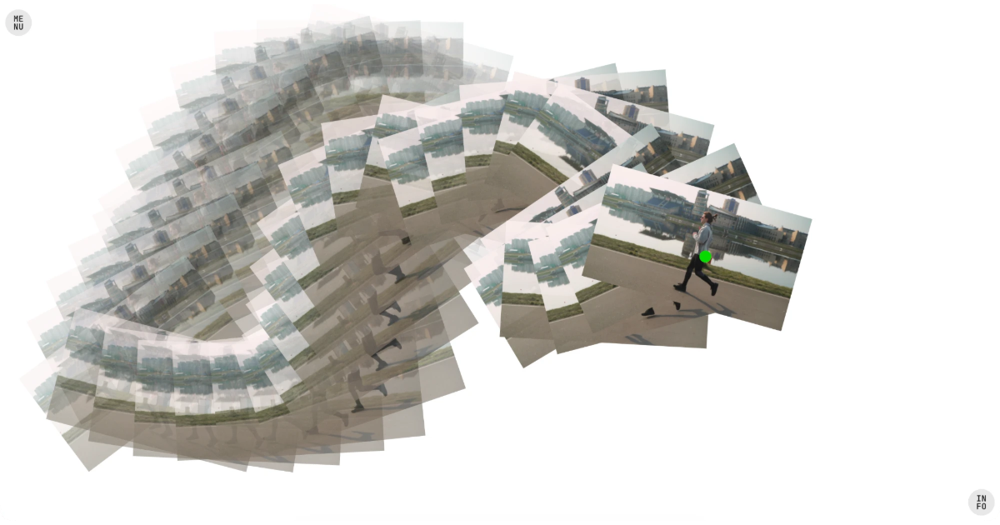

# Moving Images

**Live:** https://dinefining.github.io/moving-images/



Upload a video, move your cursor, and watch the video play out as a trail of frames — each step of the cursor stamps the next frame along your path.

Everything runs in the browser; no build step, no server code, and your video never leaves your machine.

## Run it

Open `index.html` in a browser, or serve the folder:

```
python3 -m http.server 8000
```

then visit http://localhost:8000.

## Controls

| Control | What it does |
|---|---|
| Size | Width of each frame |
| Spacing | Cursor distance between frames |
| Trail | Frames kept on screen (∞ paints permanently) |
| Tilt | How much frames rotate with your movement |
| Frame step | Use every Nth frame |
| Fade / Retract / Scale | Toggles (Scale shrinks older frames so the trail tapers) |
| PNG / Record | Export a still or an MP4 of your session (the cursor dot and menus are never included) |

Hover a slider to see its value. Drag a video anywhere onto the page to load it.

Keys: **H** menu · **Esc** close panels · **C** clear · **S** save PNG · **R** record

## Files

- `index.html` — page markup and controls
- `style.css` — styles
- `app.js` — frame capture, trail logic, rendering, export
- `og.png` — 1200×630 social sharing image

## Deploy

Push to a repo named `moving-images` under `dinefining` and turn on **Settings → Pages → Deploy from branch (main, root)**. The share-preview tags in `index.html` point at `https://dinefining.github.io/moving-images/`, so if the repo name or URL changes, update the `og:` / `twitter:` / canonical URLs to match.
